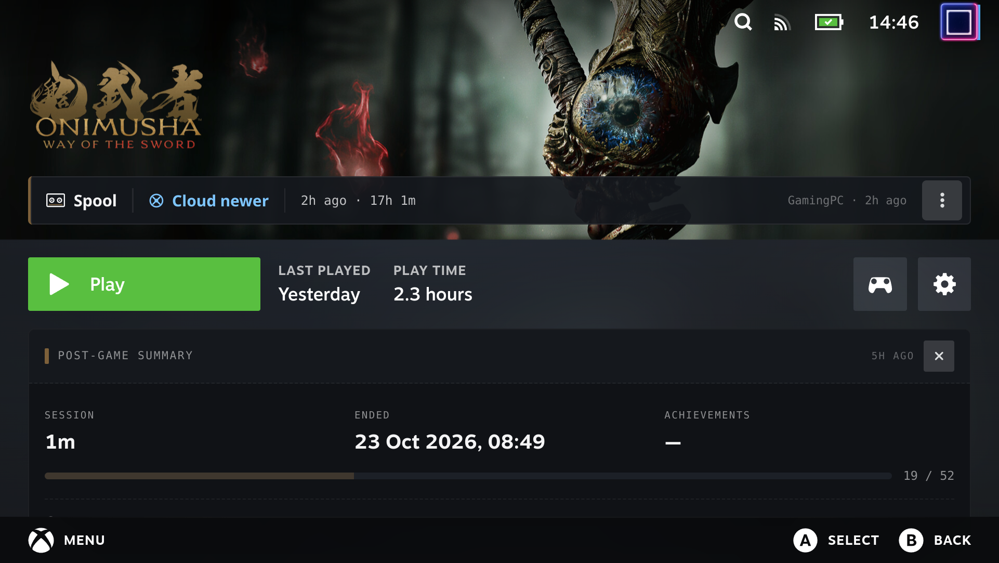
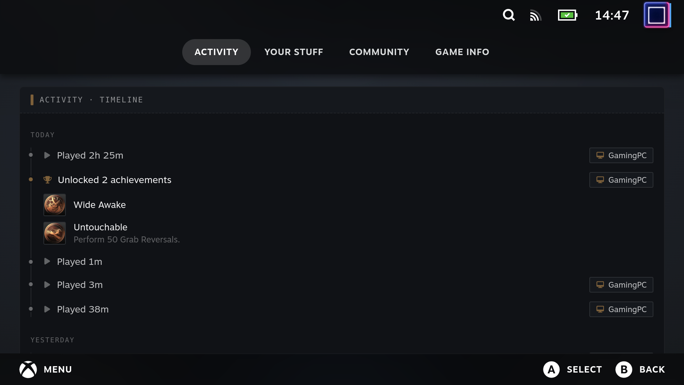
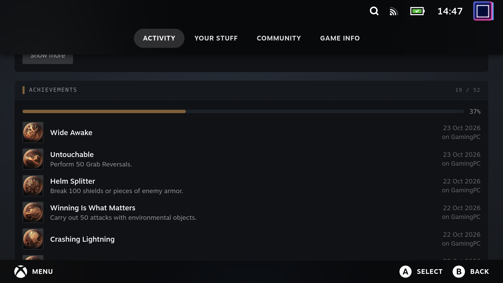

On the game page of a game Spool manages, the plugin adds the same activity cards the desktop app shows in its detail pane:

- **Post-game summary**, between the Play row and the tab bar: this device's most recent session (length and end time), the achievements that session unlocked, and overall progress. It stays until dismissed, or until the session is a week old; dismissal is per session, so the next session shows it again.
- **Activity timeline**, at the top of the **Activity** tab: play sessions and achievement unlocks grouped by day, across every device, with the device named on entries that weren't this one.
- **Achievement list**, below the timeline: every achievement, unlocked first (newest first, with the device it was unlocked on), then locked ones by how common they are. Hidden achievements show no name or description until unlocked.

Games Spool doesn't manage are left as Steam renders them.

## Data

The cards read two headless-server endpoints, keyed by the Spool game id (the appid is matched to a game with `findSpoolGame`, see [Library & launching](./library-and-launch)):

- `GET /games/{id}/achievements` — the desktop `get_game_achievements` result. The server first scans the game's Steam-emulator stats files, so unlocks earned outside Spool appear, and publishes any new ones to other devices. Icons copied from a game's `steam_settings` are served from `/achievement-icons/…`; Steam Web API icons are CDN URLs.
- `GET /games/{id}/sessions` — every device's play sessions for the game, plus this device's id.

`useGameActivity` loads both when the page opens and shares the result between the summary and the Activity tab. It loads them again when the game's last-played time moves, and once the page's cross-device fold (`POST /fold`) has changed something, so unlocks folded in from other devices appear on that visit. Matching unlocks to sessions and grouping by day is `tauri/src/lib/activity.ts`, the same module the desktop app uses; the plugin imports it from the app's source tree rather than keeping a copy.

## How the cards get onto the page

The summary and Activity-tab cards hook in from the same `/library/app/:appid` route patch as the [Spool bar](./playtime-badge), but not by walking the React tree further down: one of the components between the page and its tabs is a class that redefines `render` on the instance after its first call, so a tree patch through it only sees the first render.

Instead, `src/lib/activity-patch.tsx` uses how the page renders its tabs. The page reads its tabs component from a React context, set by a Provider above it. The patch wraps the page's output in a nearer Provider for the same context, whose value is the original component with its output patched:

- Under the tabs component, the component holding `fnOnCancelFromTabHeader` builds the tab list and renders the tab strip with `tabs: [{ id, title, content }]`. The Activity tab's id is `WhatsNew`; its `content` gets the timeline and achievement list prepended to Steam's own.
- In the tabs component's own output, the element whose children hold both the Play row and the tab bar gets the post-game summary inserted before the tab bar.

The context is found by its default value — a fallback tabs component taking `setSections` and `concise` — by searching webpack's module factories directly: its module loads after Decky indexes Steam's modules at startup, so `findModuleExport` misses it. The default is read from `_currentValue2`, because React DOM puts the Provider's value in `_currentValue` while the page renders.

If any of this isn't found on a Steam build, the plugin logs a `[Spool]` warning and leaves the page as Steam renders it.

## Controller navigation

Steam's game page scrolls to follow controller focus, so every part of a card that should be reachable is a focus stop: the summary's dismiss button, each day of the timeline and its "Show more" button, and each achievement row.
